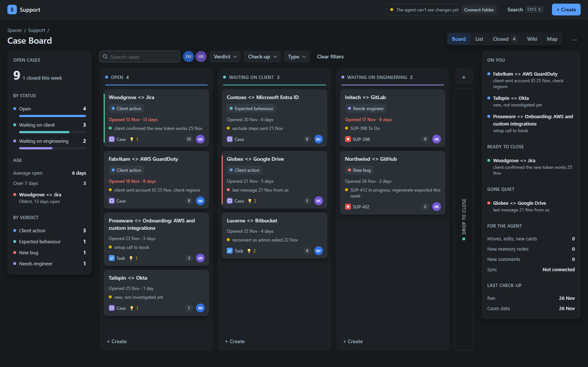
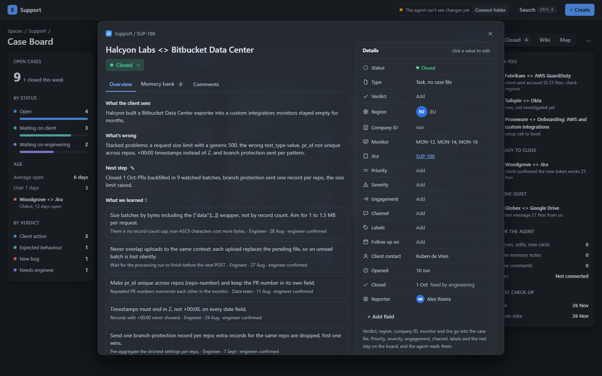
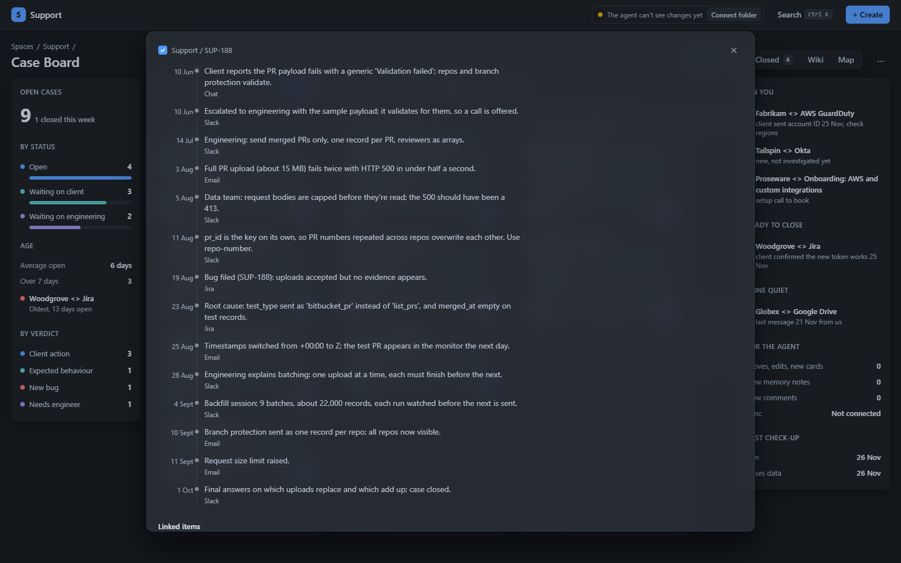
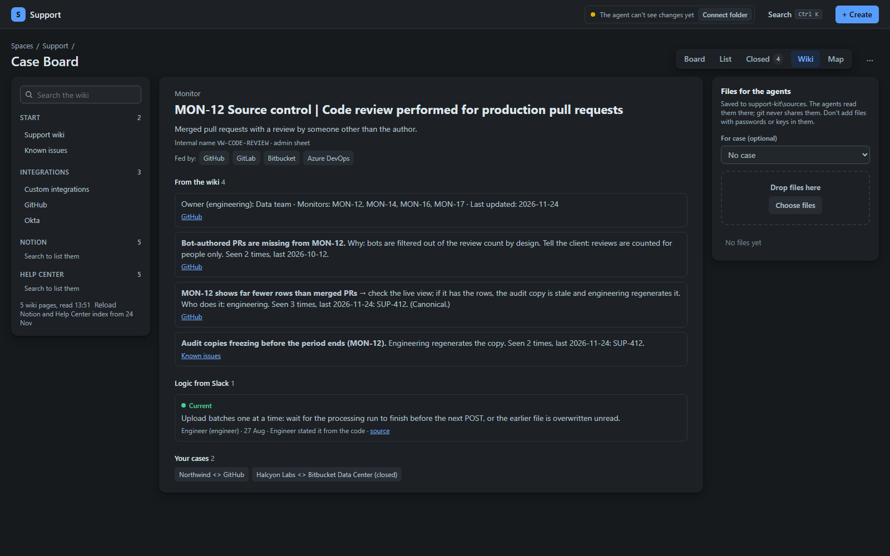
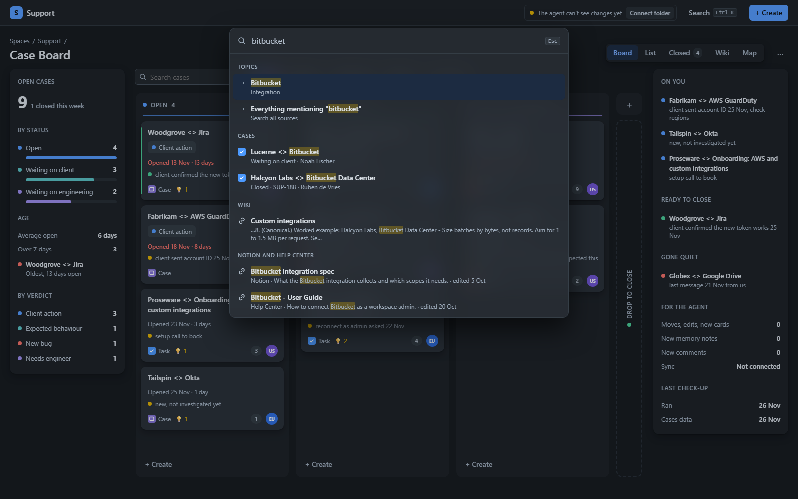
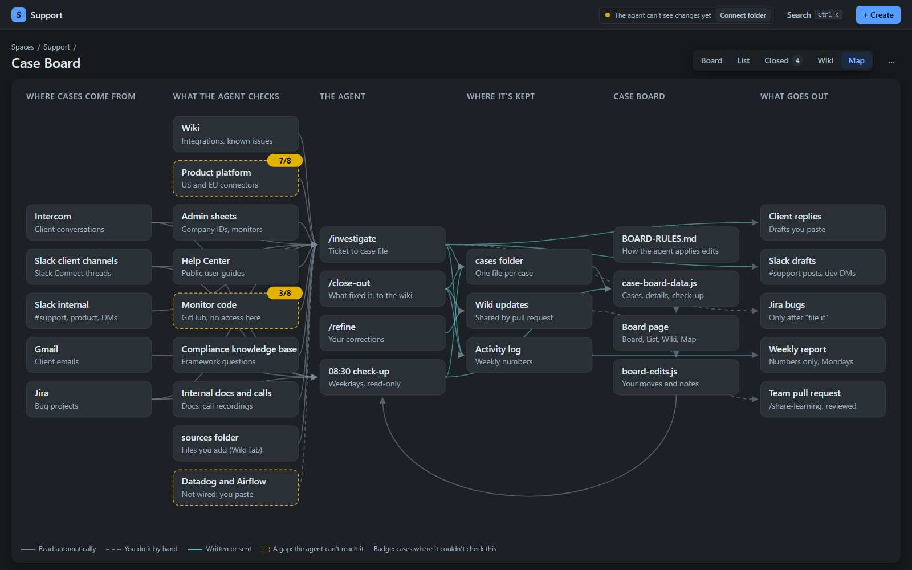

# Support Ops Board

A Jira-style case board I built for my own technical support work. It sits on top of an AI support agent: the agent investigates tickets and writes a case file per issue, and this board is where I see all of it at once, move things along, and look up what we already know about an integration or a monitor.

Everything here runs locally. The page is a single HTML file that reads a few JavaScript data files next to it, so there is no server and no database, and case data never leaves my machine. The data in this repo is fictional demo data: the companies, people, tickets and links are made up, but the kinds of problems are the ones I actually deal with (integrations failing after a reconnect, monitors showing fewer rows than expected, custom integrations rejecting payloads).

## What it does

The board has my open cases in columns (open, waiting on the client, waiting on engineering), and closed ones on their own tab so nothing gets lost. Cards show the verdict, how long a case has been open, the latest signal from the daily check-up and any Jira tickets. The right rail shows what's on me, what looks ready to close and what has gone quiet.

Clicking a card opens the full case: what the client sees, what's wrong, the next step, recommendations with sources, linked items, editable details, and for the long ones a timeline and the rules we learned from it.

The Wiki tab turns the team wiki, internal docs, help center articles and the monitor list into one place to look things up. Search a monitor, an integration or just an error and you get a topic page with the wiki lines that mention it, logic pulled from Slack (marked current, unsure or superseded), recent release notes, the matching help articles and my cases on it.

Ctrl+K searches everything at once: cases, tickets, contacts, topics and docs.

The Map tab is a diagram of how the sources, the agent, the files and the board connect, with the gaps marked. The badges count how many cases the agent couldn't check a source on, which is how I found that one connector was missing on most of my cases.

## How it stays current

A scheduled check-up runs every weekday morning. It reads each open case's source (chat, email, ticket) read-only, decides whether the case looks solved, is waiting on someone, or has gone quiet, finds new issues I've picked up since the last run and adds them as cards, and applies the moves I made on the board back to the case files. It caches what it saw per case, so on most days it only re-reads what changed, and once a week it does a full pass.

Knowledge comes in the same careful way. Logic from Slack threads and DMs with engineers is mined into a review list first, every fact with its date, who said it and a link, and checked against later release notes so outdated answers get marked superseded instead of quietly used. Only what I approve goes into the wiki.

Two rules shaped all of it. Every outside source is read-only: the board and the check-up never post, reply, comment or edit anywhere. And nothing is published: the real board, its data and the case files stay local.

## Running the demo

Open `index.html` in Chrome or Edge. The demo data loads automatically, and the Wiki tab uses a small built-in demo wiki. Connecting a real folder (the "Connect folder" button) uses the browser's File System Access API, which is why it needs a Chromium browser.

You can also open a view directly, which is how the screenshots were taken: `index.html#view=map`, `index.html#case=Northwind%20%3C%3E%20GitHub`, `index.html#wiki=topic:m:MON-12`, `index.html#search=bitbucket`, and `#theme=dark` or `#theme=light`.

## Files

`index.html` is the whole app. `case-board-data.js` holds the cases, details, check-up signals and cache. `kb-index.js` is the docs, help center and monitor index, `kb-facts.js` the facts mined from chat with their review state, and `demo-wiki.js` the demo wiki. In real use `board-edits.js` is written by the page itself to hand my moves and comments to the agent; it's git-ignored here.

## Credits

Built with Claude (Anthropic's Claude Code), which I used as a pair programmer for the page, the data shapes and the check-up prompt.
